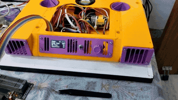

# Laptop\_Cooling\_Pad

A CAD project for a 3D-printable laptop cooling pad designed for a 14-inch Lenovo YOGA laptop. It uses an ATmega16 controller, two 12 V cooling fans rated at 20,000 RPM, and one 5 V fan rated at 6,000 RPM.

## Project Demonstration

### Project Video

  

  <a href="https://alok9coder.github.io/Laptop_Cooling_Pad/" style="display:inline-block;padding:14px 28px;background:#d73a49;color:white;border-radius:6px;font-size:18px;font-weight:bold;text-decoration:none;">&#9654; Play Full Video with Fan Audio</a>

  <a href="https://alok9coder.github.io/Laptop_Cooling_Pad/">Open the playable video player</a>
  &nbsp;|&nbsp;
  <a href="./Images/VID20261027083759.mp4">Download the full-resolution MP4</a>

### 🖼️ Image Gallery

View all images from the project in our comprehensive image gallery:

<b>📚 Click to see gallery button</b>

*Click the button above to view all project images in an elegant, responsive gallery.*

### CAD Design

  
  

  
  

### Built Project

  
  

  
  

### Final Machine

  
  

  

